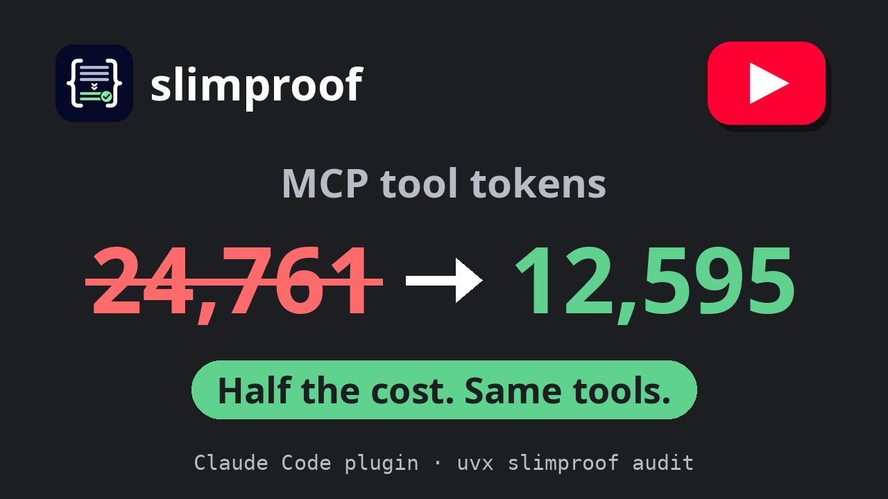

<p align="center">
  
</p>

<h1 align="center">slimproof</h1>

<p align="center">Audit and slim MCP tool definitions, with proof they still work.</p>

<p align="center">
  <a href="https://pypi.org/project/slimproof/"></a>
  <a href="https://pypi.org/project/slimproof/"></a>
  <a href="https://github.com/Rounak7721/slimproof/actions/workflows/ci.yml"></a>
  <a href="https://github.com/Rounak7721/slimproof/blob/main/LICENSE"></a>
  <a href="https://github.com/Rounak7721/slimproof/stargazers"></a>
</p>

Every MCP server you add sends its tool definitions to the model in each session. Long descriptions use context and cost tokens before you type anything. slimproof finds the heaviest tools, helps Claude rewrite their descriptions, and checks that only the wording changed. Then Claude Code can use the slim versions.

<p align="center">
  
</p>

<p align="center">
  <a href="https://youtu.be/w__NH_zfuFQ"></a>
  <br>
  <a href="https://youtu.be/w__NH_zfuFQ">Watch the full demo on YouTube</a> (1:23, with captions)
</p>

## Results

We tested slimproof on 6 popular MCP servers with 180 requests, on Claude Haiku and Claude Sonnet. Each request checks that Claude picks the correct tool with valid arguments.

- **Same accuracy:** the slim tools and the original tools both picked the correct tool in 99% of requests, with both models.
- **Fewer tokens:** the slim tools use 16% fewer prompt tokens in total, and 54% fewer for Desktop Commander.
- **Slim is not the same as empty:** with all descriptions removed, the model makes argument errors. The slim descriptions keep the details that the model needs.

| Server | Original tokens | Slim tokens | Saved |
|---|--:|--:|--:|
| Desktop Commander | 16,047 | 7,398 | 54% |
| Filesystem | 4,961 | 4,136 | 17% |
| GitHub | 19,414 | 17,082 | 12% |
| Chrome DevTools | 12,048 | 10,671 | 11% |
| Playwright | 7,227 | 6,651 | 8% |
| Notion | 33,882 | 32,565 | 4% |

The Claude API measured these token counts; they are not estimates. Servers with long descriptions save the most. Notion and GitHub use most of their tokens for JSON schema, and slimproof never changes the schema. Method, per-server accuracy and costs: [evals/results/v0.1.md](https://github.com/Rounak7721/slimproof/blob/main/evals/results/v0.1.md).

CI runs the tests, type checks and lint on Linux, macOS and Windows, with Python 3.10 and 3.12.

## What it does

1. **Audit.** Rank every tool in your MCP configs by token cost. Flag common bloat: filler openings, text that only repeats a name or type, extra markdown, very long descriptions, sentences repeated across tools, and tools that look almost the same.
2. **Slim.** In Claude Code, the `/slimproof` skill rewrites the descriptions. A guard checks each rewrite: names, parameters and types must stay the same. Only `description` and `title` can change.
3. **Apply.** A small proxy runs between Claude Code and the server. It serves the slim descriptions and passes everything else through unchanged.

To see how each step works inside, with diagrams, read [docs/architecture.md](https://github.com/Rounak7721/slimproof/blob/main/docs/architecture.md).

## Quick start

Audit the servers in your MCP configs:

```sh
uvx slimproof audit
```

slimproof finds `.mcp.json` in the current folder, `~/.claude.json` and the Claude Desktop config. To use a different file, add `--config PATH`.

Audit one server without a config:

```sh
uvx slimproof server -- npx -y @modelcontextprotocol/server-filesystem .
```

Useful options:

- `--format table|json|markdown`: the output format.
- `--exact`: exact Claude token counts. This uses the free `count_tokens` API and needs `ANTHROPIC_API_KEY`. Without it, counts are estimates and show `~`.
- `--top 10`: show only the 10 heaviest tools. The total still counts every tool.
- `--budget 5 --window 200000`: exit with code 1 if the tools use more than 5% of the context window. Use this in CI.

## Slim a server in Claude Code

1. Install the plugin:

   ```
   /plugin marketplace add Rounak7721/slimproof
   /plugin install slimproof@slimproof
   ```

2. Run `/slimproof`, or `/slimproof <server-name>` for one server.
3. Claude shows the heaviest tools, rewrites them and shows a before and after table.
4. To use the slim version, say yes. Claude saves the slim tools to `~/.slimproof/overrides/<server>.json`.
5. In a terminal, run:

   ```sh
   uvx slimproof apply <server-name>
   ```

6. Restart Claude Code.

To go back to the original tools, run `uvx slimproof revert <server-name>` and restart Claude Code.

## How the proxy keeps you safe

- `apply` changes only that server's entry in your config. It adds `uvx slimproof proxy <name> --` in front of the real command. Your `env` and `${VAR}` values stay as they are.
- Before each change, slimproof saves a backup of the config to `~/.slimproof/backups/`. A backup is a full copy of the config, so it can contain API keys and tokens. Keep the folder private, and delete old backups when you no longer need them.
- The proxy changes only the replies to `tools/list`. Tool calls, resources, prompts and all other messages pass through unchanged.
- If a server changes a tool after you slimmed it, the proxy serves the original tool and logs a warning. Run `/slimproof` again to slim the new version.
- If the overrides file is missing or broken, the proxy serves the original tools.

## Limits

- The proxy works with **local stdio servers** in your own MCP configs. These include packages that you start with `npx`, `uvx` or `docker`, and your own scripts.
- Servers from **plugins** and **remote HTTP servers** can't use the proxy yet. You can audit and slim them, then paste the slim descriptions into the server's source. Proxy support for them is planned.
- Remote servers that need an OAuth login are skipped in the audit.
- After `apply`, the audit measures the slim tools that the proxy serves, not the originals. To see the original cost, run `slimproof revert <server-name>` first.

## Commands

| Command | What it does |
|---|---|
| `slimproof audit` | Rank the tools in your MCP configs by token cost. |
| `slimproof server -- CMD ARGS` or `--url URL` | Audit one server without a config. |
| `slimproof compare ORIGINAL.json SLIM.json` | Check slim tools against the originals: tokens saved and guard problems. |
| `slimproof apply NAME` | Start server NAME through the proxy. |
| `slimproof revert NAME` | Start server NAME without the proxy again. |
| `slimproof proxy NAME -- CMD ARGS` | Run the proxy. `apply` writes this into your config. |
| `slimproof mcp` | Run slimproof as an MCP server (the plugin uses this). |

Exit codes: `0` OK, `1` over budget or a guard problem, `2` bad input or a server that failed.

## License

MIT

<!-- mcp-name: io.github.rounak7721/slimproof -->