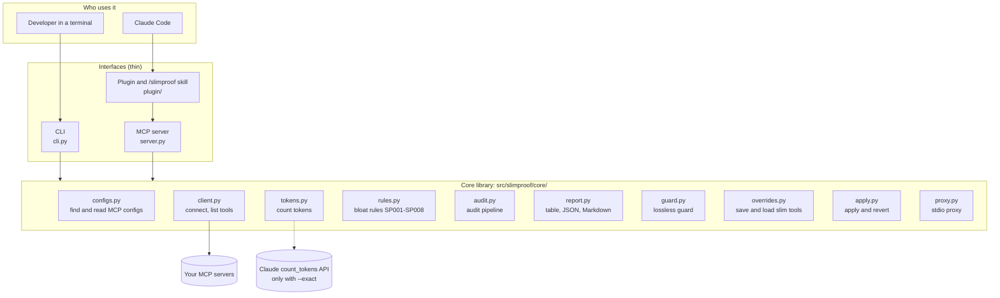
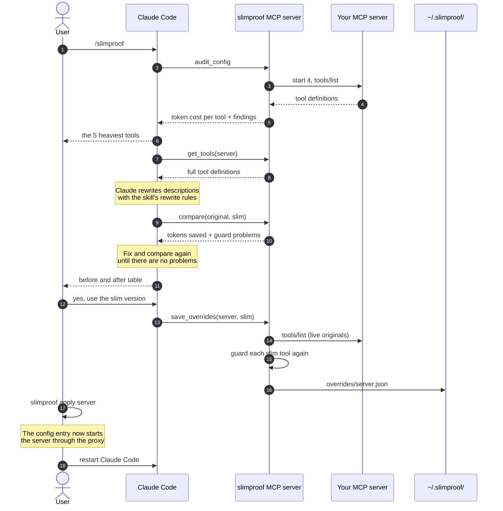
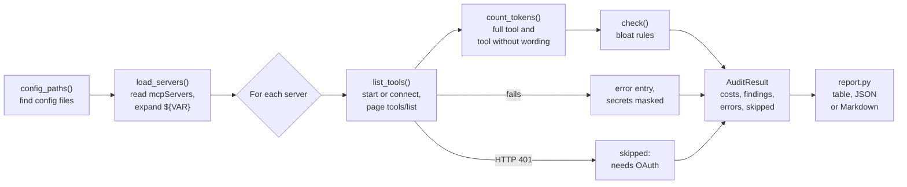
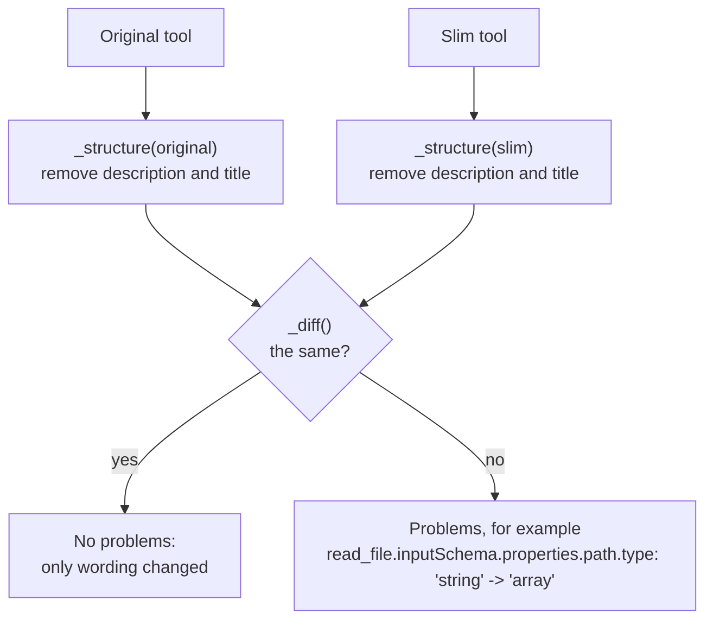
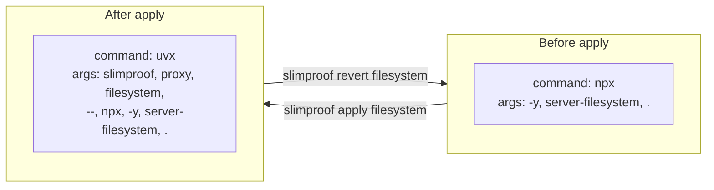
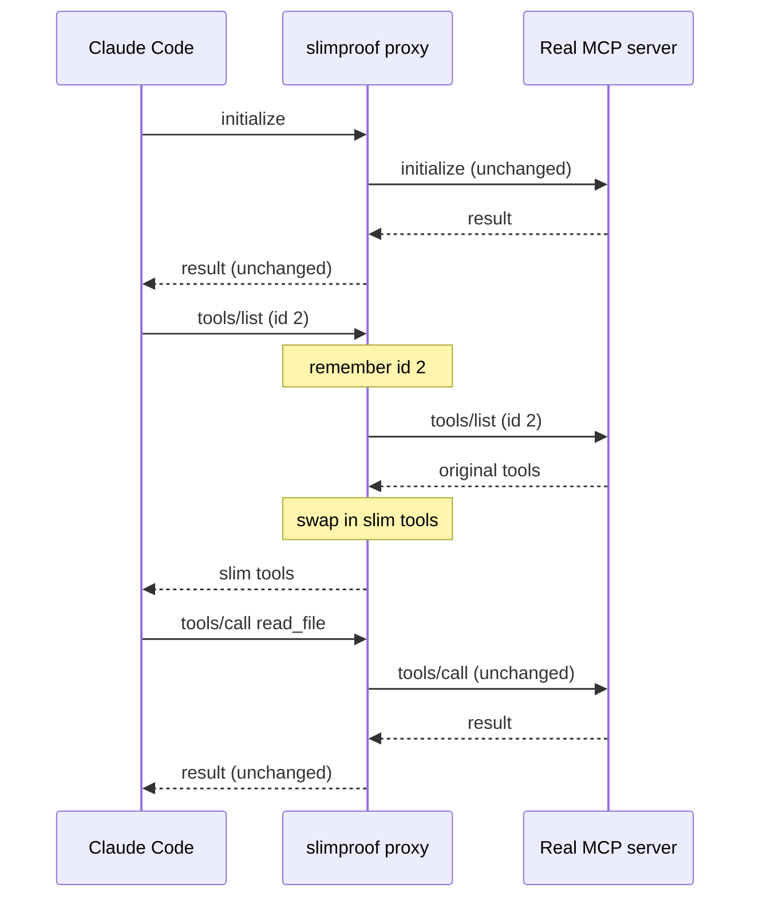
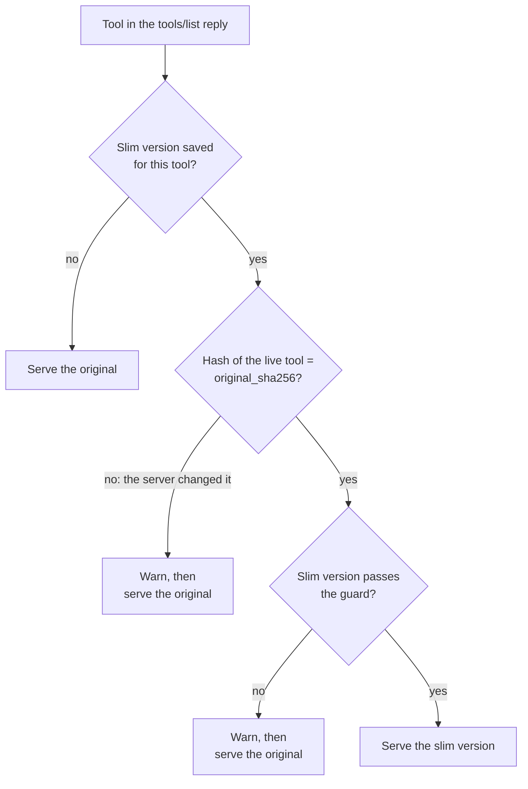
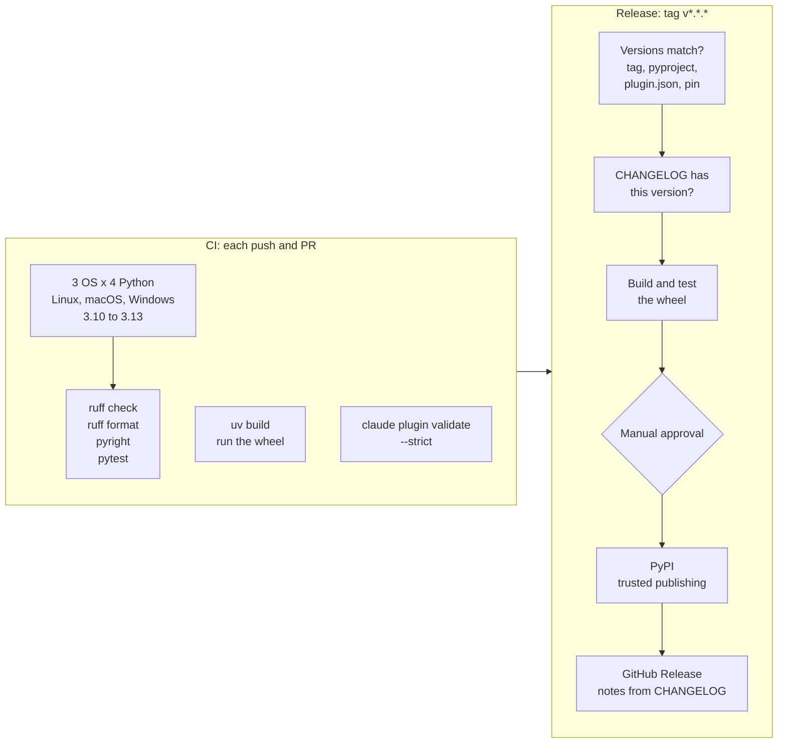

# Architecture

This document shows how slimproof works, from the audit to the proxy. It is for contributors and for users who want to know what slimproof does with their configs and servers.

## Contents

- [The big picture](#the-big-picture)
- [Code layout](#code-layout)
- [The full flow](#the-full-flow)
- [Step 1: Audit](#step-1-audit)
- [Step 2: Slim and guard](#step-2-slim-and-guard)
- [Step 3: Save and apply](#step-3-save-and-apply)
- [Step 4: The proxy at run time](#step-4-the-proxy-at-run-time)
- [Token counting](#token-counting)
- [Safety rules](#safety-rules)
- [Tests, CI and releases](#tests-ci-and-releases)
- [Limits and plans](#limits-and-plans)

## The big picture

slimproof has one core library and three thin interfaces on top of it. The interfaces only read input and show output. All logic lives in the core.



| Interface | Who calls it | What it does |
|---|---|---|
| CLI (`slimproof ...`) | You, in a terminal or in CI | Audit, compare, apply, revert, and run the proxy. |
| MCP server (`slimproof mcp`) | Claude, through the plugin | Gives Claude 5 tools: `audit_config`, `audit_server`, `get_tools`, `compare`, `save_overrides`. |
| Plugin | Claude Code | Installs the MCP server and the `/slimproof` skill. The skill tells Claude the steps to follow. |

Why this design: each feature is written and tested one time, in the core. The CLI and the MCP server can never disagree, because they call the same functions.

## Code layout

```
src/slimproof/
├── cli.py            CLI commands (Typer). No logic.
├── server.py         MCP tool registration. No logic.
└── core/
    ├── configs.py    Find config files; read mcpServers; scope order; ${VAR} expansion
    ├── client.py     Connect over stdio or Streamable HTTP; page through tools/list
    ├── tokens.py     Estimate (chars / 2.5) or exact count (Claude API)
    ├── rules.py      Bloat rules SP001-SP008
    ├── audit.py      Audit pipeline; mask secrets in error messages
    ├── report.py     Output: Rich table, JSON, Markdown; budget check
    ├── guard.py      Compare structure; refuse any change except description/title
    ├── overrides.py  Save slim tools with a hash of each original; atomic writes
    ├── apply.py      Edit one config entry to start through the proxy; backups
    └── proxy.py      Relay JSON-RPC; rewrite tools/list replies only
plugin/
├── .claude-plugin/plugin.json   Plugin manifest and icon
├── .mcp.json                    Starts `uvx slimproof==X mcp`
└── skills/slimproof/            SKILL.md, rewrite-rules.md, examples.md
```

## The full flow

This is the complete path, from the first audit to Claude Code using the slim tools.



The rest of this document explains each step.

## Step 1: Audit

`slimproof audit` (or the `audit_config` MCP tool) measures every tool in your MCP configs.



### Find the configs

`config_paths()` looks for these files, in this order:

1. `.mcp.json` in the current folder (Claude Code, project scope)
2. `~/.claude.json` (Claude Code, user and local scope)
3. The Claude Desktop config (macOS and Windows paths)

### Read the servers

`load_servers()` reads the `mcpServers` block of each file.

- If two scopes use the same server name, slimproof keeps the entry that Claude Code uses: **local > project > user**. The local scope is the `projects` entry for the current folder in `~/.claude.json`.
- `${VAR}` and `${VAR:-default}` are expanded like Claude Code does it. An unknown variable stays as written.
- An entry with `command` is a stdio server. An entry with `"type": "http"` is a Streamable HTTP server. Other types are skipped, with a reason.

### List the tools

`list_tools()` connects to each server and reads all pages of `tools/list`.

- **Stdio:** slimproof starts the server as a child process. The server's stderr goes to a temporary file. It is shown only if the server fails, and then only the last 5 lines.
- **HTTP:** slimproof connects with the headers from the config. A `401` reply means the server needs an OAuth login, so the server is skipped, not failed.
- Each reply has a 60-second timeout. A first `npx -y` run can download a package in that time.
- A server that repeats a page cursor can't make slimproof loop forever.

Servers are audited one at a time. One failed server does not stop the audit; it becomes an entry in `errors`.

### Count the tokens

For each tool, slimproof counts two things:

- the **full tool**: name, description and input schema
- the **same tool without wording**: every `description` and `title` removed

The difference is the `description_tokens` column ("In descriptions"). This is the part that slimming can make smaller. The rest is structure, and slimproof never changes it.

### Find bloat

`rules.py` runs 8 rules. They are deterministic: the same input always gives the same findings.

| Rule | Checks | Finds |
|---|---|---|
| SP001 | each tool | Filler openings, such as "This tool allows you to..." |
| SP002 | each tool | A description that only repeats the tool name |
| SP003 | each tool | A parameter description that only repeats its type |
| SP004 | each tool | Enum values repeated in the prose |
| SP005 | each tool | Markup bloat: blank-line runs, headings, bold markers, code fences |
| SP006 | each tool | Very long descriptions |
| SP007 | all tools of a server | The same sentence in many tools |
| SP008 | all tools of a server | Tools that look almost the same |

## Step 2: Slim and guard

Claude writes the slim descriptions. slimproof does not use an AI model itself. It only checks Claude's work.

The skill (`plugin/skills/slimproof/SKILL.md`) gives Claude the steps. `rewrite-rules.md` tells Claude what to cut and what to keep: keep hard constraints, never add facts.

### The lossless guard

`guard.py` makes sure that a rewrite changes **wording only**. It removes all wording from both versions of a tool, then compares what is left.



Three details make the guard correct:

1. **Names are not wording.** Inside `properties`, `$defs` and similar keywords, the keys are names that the server chose. A parameter called `title` or `description` is structure, so the guard keeps it.
2. **Data is compared exactly.** `default`, `enum`, `const` and `examples` are data, not schema. The guard compares them as they are, even if they contain a key called `description`.
3. **Every level counts.** The guard walks the whole schema: `properties`, `items`, `anyOf`, `$defs` and the rest. Claude may slim nested parameter descriptions too, and the guard checks them all.

The guard runs **three times**:

| When | Where | Why |
|---|---|---|
| Claude calls `compare` | `guard.compare()` | Claude sees the problems and fixes them before it shows you the result. |
| Claude calls `save_overrides` | `overrides.save_overrides()` | slimproof reads the live tools again and checks against them. Nothing is saved if one tool fails. |
| Each `tools/list` in the proxy | `proxy.slim_tools()` | A hand-edited overrides file can't send a broken tool to Claude Code. |

The guard proves that the **structure** did not change. It can't prove that the **meaning** stayed the same. The eval does that: see [evals/results/v0.1.md](../evals/results/v0.1.md).

## Step 3: Save and apply

### Save the slim tools

`save_overrides()` writes `~/.slimproof/overrides/<server>.json`:

```json
{
  "version": 1,
  "server": "filesystem",
  "tools": {
    "read_file": {
      "original_sha256": "3f1c...",
      "slim": { "name": "read_file", "description": "...", "inputSchema": { } }
    }
  }
}
```

- `original_sha256` is a hash of the original tool as canonical JSON. The proxy uses it to see if the server changed the tool later.
- Earlier slim tools of the same server are kept while their original is unchanged.
- The file is written atomically: slimproof writes a `.tmp` file, then replaces the old file in one step. A reader never sees half a file.
- The server name must use only letters, digits, `.`, `_` and `-`, so the path can't leave the overrides folder.

### Apply the proxy

`slimproof apply <name>` changes **one entry** in **one config file**: the file where Claude Code reads that server.



- The real command stays in the entry, after `--`. `revert` reads it from there, so it needs no other state.
- `env`, `${VAR}` values and all other fields stay as they are.
- Before each change, slimproof copies the whole config file to `~/.slimproof/backups/`.
- `apply` refuses if no slim tools are saved, if the server is not stdio, or if the server already uses the proxy.

## Step 4: The proxy at run time

After a restart, Claude Code starts `slimproof proxy <name> -- <real command>`. The proxy starts the real server and sits between the two.



### How the proxy works

- It relays **raw JSON-RPC lines**. It does not use an MCP library for the relay, so new protocol methods pass through without changes to slimproof.
- It remembers the `id` of each `tools/list` request from the client. It rewrites only the replies with those ids.
- When no `tools/list` reply is pending, it does not parse lines at all. Big resource and tool-call results pass through fast.
- The server's stderr goes straight to Claude Code's logs. The proxy writes its own warnings to stderr too.
- The proxy reads stdin in a separate thread. This works on Linux, macOS and Windows.
- When the real server exits, the proxy exits with the same exit code.

### The decision for each tool



The rule is simple: **if anything is unexpected, serve the original.** A missing or broken overrides file also gives the original tools. The worst case is that you get the original token cost, never a broken tool.

When the proxy serves a slim tool, it keeps any fields from the live tool that the slim version does not have. Only the wording comes from the overrides file.

## Token counting

| Mode | How | When to use |
|---|---|---|
| Estimate (default) | Characters of the tool JSON / 2.5, rounded up. Shown with `~`. | Fast, offline, free. Good for ranking tools. |
| Exact (`--exact`) | Claude's free `count_tokens` API, with your own `ANTHROPIC_API_KEY`. | When you need the real number. |

The ratio 2.5 comes from measurements on 6 servers: 2.24 to 3.16 characters per Claude token for MCP tool JSON (average 2.59). Change it with `--ratio`.

The exact mode measures what one tool **adds** to a request. It counts a request with one small "anchor" tool, then a request with the anchor and the target tool, and takes the difference. The client retries up to 5 times, so per-minute rate limits on big servers are not a problem.

## Safety rules

slimproof reads files that can hold API keys. These rules apply everywhere:

- **Secrets are never printed.** Error messages mask stdio `env` values, HTTP header values, URL query values and URL passwords. Server names never include a URL query or a password.
- **Only wording changes.** The guard checks every rewrite, three times (see [the lossless guard](#the-lossless-guard)).
- **Configs are backed up.** `apply` and `revert` copy the full config before they change it. A backup can contain API keys, so keep `~/.slimproof/backups/` private.
- **Writes are atomic,** and a config keeps its file permissions.
- **The proxy fails safe.** Anything unexpected gives the original tools.

## Tests, CI and releases



- **Tests** use a small Python MCP server with bloated tools (`tests/fixtures/bloated_server.py`), so they need no network and no Node.js.
- **Trusted publishing** means that PyPI trusts this GitHub workflow directly. There is no PyPI API token to leak.
- **Version checks** stop a release if the tag, `pyproject.toml`, `plugin.json` and the plugin's `slimproof==X` pin disagree.

## Limits and plans

- The proxy works only with **local stdio servers** in your MCP configs. Plugin servers and remote HTTP servers can be audited and slimmed, but not proxied yet. An HTTP proxy is planned.
- Servers that need an OAuth login are skipped in the audit.
- v0.1 supports Claude only: Claude Code, Claude Desktop configs and Claude token counts. Other clients and tokenizers come later.
- The guard proves structure, not meaning. The eval covers 6 servers.
